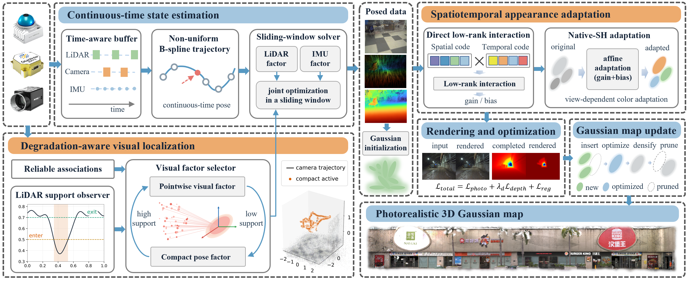

<h2 align="center">DA-LIVGS: Degradation-Aware LiDAR–Inertial–Visual Gaussian Splatting SLAM with Adaptive Geometric Constraints and Spatiotemporal Appearance Modeling ✨</h2>

<p align="center">
  
</p>

DA-LIVGS is a LiDAR–inertial–visual Gaussian Splatting SLAM system for challenging scenes with weak geometry, weak texture, exposure changes, low illumination, and tunnel-like motion. This pre-acceptance snapshot provides the project organization, configuration files, interfaces, documentation, and selected implementation components. The complete implementation will be added after paper acceptance.

## Release roadmap 🗺️

- [x] Project structure, interfaces, and selected implementation components
- [x] Paper-profile configuration and launch files
- [x] Build, run, and validation workflow documentation
- [ ] Additional evaluation utilities and supplementary material
- [ ] Complete source release after paper acceptance

The complete implementation and reproduction-ready source tree will be released after the paper is accepted.

## Datasets 📦

Download the datasets from their original project pages and keep the downloaded files outside this repository.

- [R3LIVE dataset](https://github.com/ziv-lin/r3live_dataset)
- [FAST-LIVO](https://github.com/hku-mars/FAST-LIVO)
- [FAST-LIVO2](https://github.com/hku-mars/FAST-LIVO2) and the [HKU-MARS dataset page](https://mars.hku.hk/dataset.html)
- [GEODE project page](https://thisparticle.github.io/geode/) and [GEODE dataset repository](https://github.com/PengYu-Team/GEODE_dataset)

The configuration files cover R3LIVE Deg.00–02, FAST-LIVO Visual Challenge and LiDAR Degenerate, FAST-LIVO2 Bright Screen Wall, CBD Building 01 and Retail Street, GEODE sequences, and the Airy-Seeker camera variants.

## Repository layout 🧭

```text
catkin_ws/src/da_livgs_frontend/   ROS interfaces, configurations, and selected front-end components
catkin_ws/src/da_livgs_mapping/    Mapping interfaces, configurations, and selected assets
catkin_ws/src/da_livgs_mapping/config/
                                    Paper-profile mapping configurations
scripts/                            Build, run, and validation entry points
benchmarks/                         Compact source and profile metadata
docs/                               Reproduction notes and documentation assets
environment/                        Dependency notes
```

## Requirements ⚙️

- Ubuntu 20.04
- ROS Noetic
- GCC with C++17 support
- CUDA 11.7 and an NVIDIA GPU
- LibTorch 2.0.1 with CUDA 11.7
- TensorRT 8.6
- OpenCV 4.7, PCL 1.13, Ceres 2, Eigen, and yaml-cpp
- Python 3 with NumPy

The build scripts use versioned dependencies under `/home/yt/Libraries` by default. Change the paths below when the local installation uses another directory.

```bash
source /opt/ros/noetic/setup.bash
export DA_LIVGS_DEPENDENCY_ROOT=/home/yt/Libraries
export CUDA_HOME=$DA_LIVGS_DEPENDENCY_ROOT/cuda-11.7
export Torch_DIR=$DA_LIVGS_DEPENDENCY_ROOT/libtorch-2.0.1-cu117/share/cmake/Torch
export TENSORRT_ROOT=$DA_LIVGS_DEPENDENCY_ROOT/TensorRT-8.6.1.6
export GLM_INCLUDE_DIR=$DA_LIVGS_DEPENDENCY_ROOT/glm-0.9.9.8
export OpenCV_DIR=$DA_LIVGS_DEPENDENCY_ROOT/opencv/opencv-4.7.0/build
export PCL_DIR=$DA_LIVGS_DEPENDENCY_ROOT/pcl-1.13.1/install/share/pcl-1.13
export DA_LIVGS_CMAKE_ARGS="-DCeres_DIR=$DA_LIVGS_DEPENDENCY_ROOT/ceres-2.0.0/install/lib/cmake/Ceres -DLIVOX_SDK_ROOT=$DA_LIVGS_DEPENDENCY_ROOT/livox-sdk-2.3.0/install"
```

## Prepare SPNet 🔩

The complete mapping release uses TensorRT engines for SPNet. Download `Large_300.pth` from the [upstream model distribution](https://drive.google.com/file/d/11dujPvi4L4pKLEXytXK0mEmPBNQDqgEak/view?pli=1) and place it in `catkin_ws/src/da_livgs_mapping/ckpt/`.

Create the documented SPNet environment, export both ONNX models, and build the TensorRT engines.

```bash
cd catkin_ws/src/da_livgs_mapping/ckpt
./setup_spnet.sh
./export_onnx.sh
DA_LIVGS_DEPENDENCY_ROOT=/home/yt/Libraries ./build_trt.sh
```

The generated model files stay ignored by Git. They are required only for running the mapping node.

## Build 🔧

The current pre-acceptance snapshot does not contain the complete implementation required for a full build. The commands below document the build workflow for the complete source release.

```bash
cd /home/yt/Algorithm/DA-LIVGS
./scripts/build.sh
source catkin_ws/devel/setup.bash
```

Use `DA_LIVGS_BUILD_JOBS=1` or `DA_LIVGS_BUILD_JOBS=2` on machines with limited memory.

## Run ▶️

After the complete source release is available, start the mapping node first and then start the front end in a second terminal. The following example uses the FAST-LIVO2 CBD Building 01 sequence.

```bash
./scripts/run_mapping.sh \
  --config config/da_livgs_fastlivo2_balanced.yaml \
  --output /tmp/da_livgs_runs/cbd
```

```bash
./scripts/run_odometry.sh \
  --config /config/da_livgs_fastlivo2.yaml \
  --bag /path/to/CBD_Building_01.bag \
  --rviz false
```

Use the matching front-end and mapping configurations for R3LIVE, FAST-LIVO, FAST-LIVO2, GEODE, or Airy-Seeker sequences. The mapping process writes the Gaussian map and held-out rendering metrics to the directory passed with `--output`.

Short runs are useful for checking topic connections and resource setup.

```bash
./scripts/run_odometry.sh \
  --config /config/da_livgs_fastlivo2.yaml \
  --bag /path/to/CBD_Building_01.bag \
  --start 0 \
  --duration 10 \
  --rviz false
```

## Validation ✅

Validation is enabled for the complete source release and checks the mapping end-of-stream marker, finite metrics, the Gaussian map, and the per-view evaluation output.

```bash
python3 scripts/validate_run.py /tmp/da_livgs_runs/cbd
```

## Citation 📄

The DA-LIVGS paper is currently under review. The formal citation will be added after acceptance.

## Acknowledgements 🙏

Our work builds on [Gaussian-LIC2](https://xingxingzuo.github.io/gaussian_lic2/). We thank the authors of [FAST-LIVO2](https://github.com/hku-mars/FAST-LIVO2), [R3LIVE](https://github.com/ziv-lin/r3live), [3D Gaussian Splatting](https://github.com/graphdeco-inria/gaussian-splatting), and [DALI-SLAM](https://github.com/DCSI2022/DALI_SLAM) for their ideas, implementations, and public resources.

## License 📜

DA-LIVGS is released under the GNU General Public License v3 or later. See [LICENSE](LICENSE).
